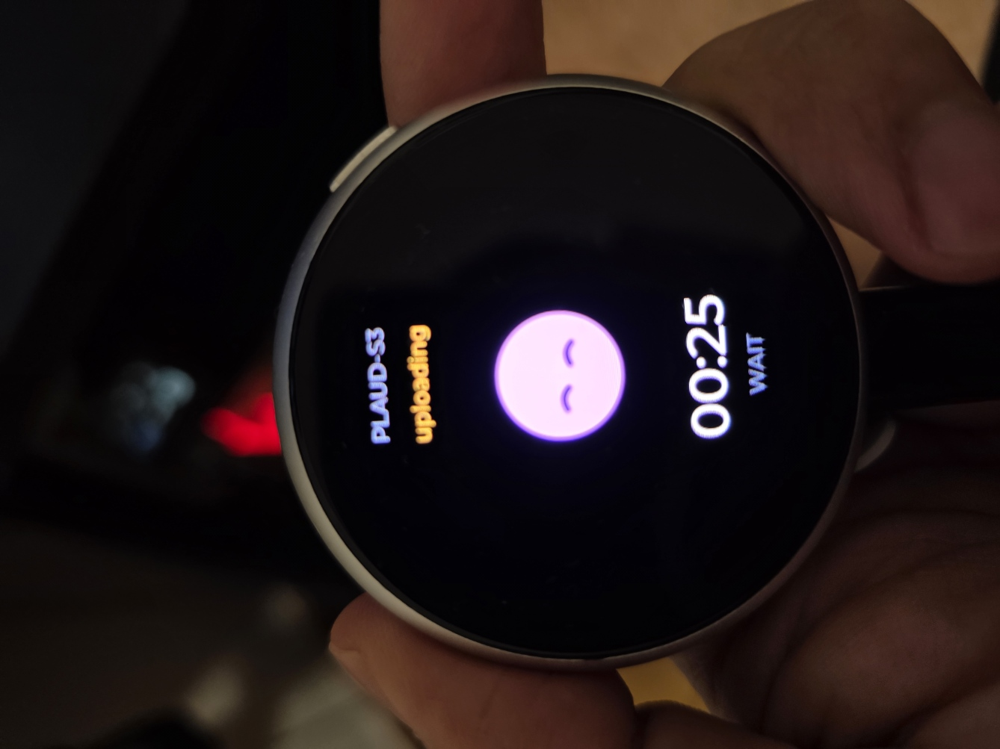
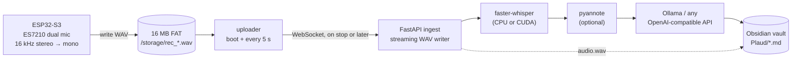
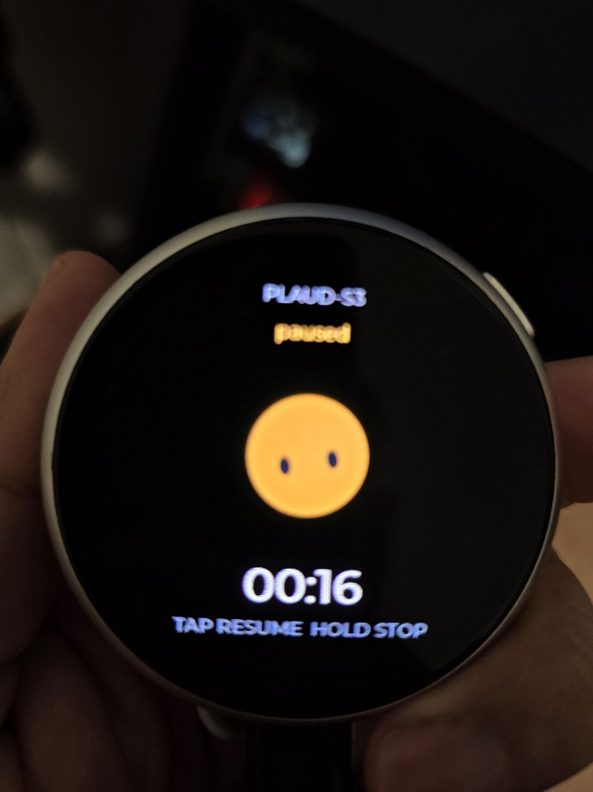
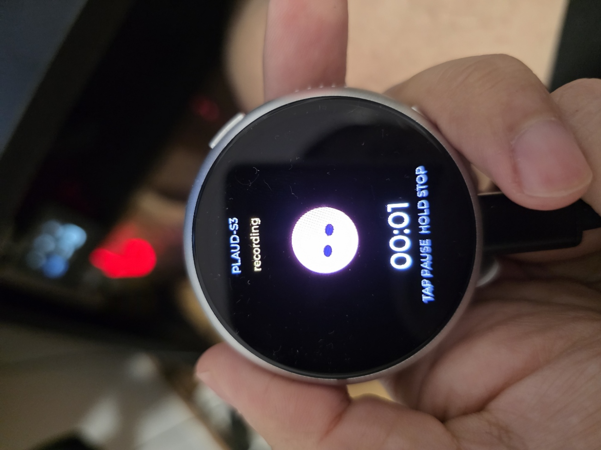
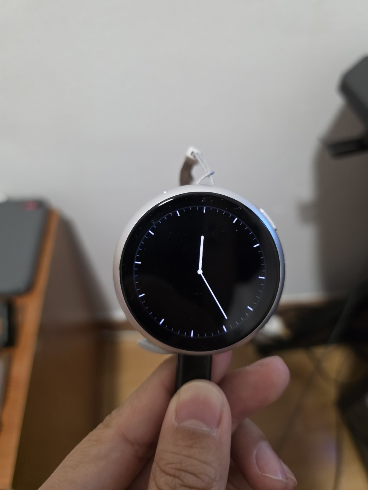

# plaud-s3

**A Plaud-Note-style voice recorder you own end to end.** An ESP32-S3 watch-style board records
dual-mic audio to its own flash first, uploads it to a server on your LAN whenever that server
is reachable, and the server writes the transcript, summary and Markdown note straight into
your Obsidian vault.

No vendor cloud, no subscription minutes, no phone app in the middle.


[](https://github.com/PovedaAqui/plaud-s3/actions/workflows/server.yml)
[](https://github.com/PovedaAqui/plaud-s3/actions/workflows/firmware.yml)




*Recording in hand: pink `gaze` avatar, elapsed time, tap-to-pause hint. The paused state is
further down.*

---

## What it does

- **Record offline** — audio is written to a 16 MB FAT partition as a WAV; the uploader sends
  it when the server is reachable, so a dead LAN or a reboot loses nothing.
- **Record** — tap the screen or a side key; the ES7210 reads two digital mics at 16 kHz.
- **Pause and resume** — tap again; the paused stretch is dropped server-side, so the WAV has
  no silent gap and the timer excludes it.
- **Transcribe** — `faster-whisper` on your machine (or any GPU box you point it at).
- **Label speakers** — optional `pyannote` diarization, with a Hugging Face token.
- **Write notes** — summaries, action items and topics from any OpenAI-compatible endpoint
  (Ollama by default), with an honest "no summary" fallback when no LLM answers.
- **Publish** — `audio.wav`, `transcript.{txt,json}`, `notes.md`, `meta.json` per recording,
  plus a copy under `<vault>/Plaud/`.

If the model is unreachable, nothing is invented: the note says so and keeps the raw transcript.

## Architecture



The device is a thin capture client on purpose: no model, no transcript, no cloud state. It only
owns the audio it has not managed to upload yet.

### Adding a microSD card

The storage layer is volume-agnostic: `storage_init()` mounts the internal FAT partition, then
tries SDMMC 1-bit at `/sdcard` when enabled. If a card answers, new recordings go there; files
already pending on the internal partition are still uploaded first.

```
menuconfig → Plaud-S3 recorder
  [*] Mount a microSD card when one is wired
      microSD CLK / CMD / D0 GPIO
      microSD clock (kHz)
```

It is off by default on purpose: the board has no card slot, and driving guessed pins could
disturb the display or I2C bus. Set the pins to match the wiring before enabling. There is no
hot-swap detection — a card is picked up at boot, and removing it mid-recording stops the take
with `storage full`.

## Hardware

| Property | Value |
|---|---|
| Board | Waveshare ESP32-S3-Touch-AMOLED-1.75C |
| MCU | ESP32-S3, 32 MB flash, 8 MB octal PSRAM |
| Display | 1.75″ 466×466 QSPI AMOLED (CO5300), CST9217 touch |
| Audio | dual digital mics via ES7210 ADC, ES8311 codec, speaker |
| Sensors / power | QMI8658 IMU, AXP2101 PMIC |
| Battery | 500 mAh LiPo (702530, 3.7 V, 1.85 Wh) on the retail unit |
| Board revision | Rev1.1 (silkscreen) |
| Buttons | Key1 → GPIO0 (BOOT); Key2 → AXP2101 `PWRON` (not a GPIO) |
| Storage | 16 MB FAT partition (`/storage`, wear-levelled), ~8 min at 16 kHz mono; optional microSD |
| USB | native USB-Serial/JTAG (`303a:1001`) |

A 16 MB flash backup covering the bootloader, partition table, `nvs` and factory app was taken
before the first flash.



## Repository layout

```
firmware/
  main/main.c        boot: display, UI, Wi-Fi, recorder, buttons
  main/recorder.c    codec → downmix → local WAV; pause/toggle state machine; uploader
  main/ui.c          LVGL screen: DiceBear avatar, timer, hint, long-press stop
  main/buttons.c     GPIO0 polling + AXP2101 PWRON interrupt-status polling
  main/storage.c     FAT mount (internal + optional SD), pending queue, next path
  main/avatars.c     LVGL descriptors for the linked avatar blobs
  main/assets/       avatar_*.bin — 240×240 RGB565, generated
  assets/avatars/    DiceBear PNG sources
server/
  app/main.py        /ws/audio, /health, /recordings
  app/pipeline.py    ASR, optional diarization, LLM notes, vault export
  app/wavio.py       streaming WAV writer
  tools/send_wav.py  replay a WAV through the real protocol
  tests/             56 tests, ~90% coverage
scripts/
  configure_wifi.sh  credentials → sdkconfig.local → BSP patch → build
  gen_avatars.py     fetch DiceBear variants and write the .bin blobs
  sync_usb_time.py   set the clock over USB when there is no network
  patch_bsp_display.sh  display-driver fixes after the component manager refetches
docs/images/         README assets
examples/meeting/    one complete run: audio, transcript, note
.github/workflows/   server tests + ESP-IDF build
CONTRIBUTING.md      dev setup, tests, PR rules
SECURITY.md          private reporting, trust model
LICENSE              MIT
```

## Quick start

### 1. Server

```bash
cd server
python3 -m venv .venv && .venv/bin/pip install -e .[dev]
PLAUD_DATA_DIR=./data \
PLAUD_VAULT_DIR="$HOME/Documents/Obsidian" \
  .venv/bin/uvicorn app.main:app --host 0.0.0.0 --port 8000
```

First recording downloads the ASR model (`small` by default, ~460 MB). Configuration is
environment-only; see [`.env.example`](server/.env.example).

### 2. Credentials and firmware

Credentials and the server address never live in git: `scripts/wifi.env` and
`firmware/sdkconfig.local` are ignored, and both are required (`configure_wifi.sh` refuses to
build without an SSID and a `ws://` URL). Model, endpoint and decoding options are environment
variables, so no values are baked into the repository.

```bash
cp scripts/wifi.env.example scripts/wifi.env
$EDITOR scripts/wifi.env          # 2.4 GHz SSID + password + ws://<server-ip>:8000/ws/audio
./scripts/configure_wifi.sh       # regenerates sdkconfig, patches the BSP, builds
```

Requires ESP-IDF 5.5.x: `source ~/esp-idf/export.sh` first.

### 3. Flash

```bash
cd firmware
idf.py -p /dev/ttyACM0 flash monitor
```

On WSL with the device still bound to Windows, flash from PowerShell instead — and write the
three images individually, because a merged image at `0x0` would also overwrite the `nvs`
partition at `0x9000`:

```powershell
py -3 -m esptool --chip esp32s3 -p COM4 -b 921600 write_flash `
  --flash_mode dio --flash_freq 80m --flash_size 32MB `
  0x0 bootloader.bin 0x8000 partition-table.bin 0x10000 plaud_s3.bin
```

### 4. Use it

Tap the avatar to record, tap to pause, tap to resume, hold to stop and save. The note appears
in `<vault>/Plaud/` a few seconds later.

## UI states


All states share one DiceBear `gaze` mascot (10.x); body colour and eye variant carry the mood.

| State | Shape | Eyes | Body | Hint |
|---|---|---|---|---|
| connecting | circle | `dots` | `#9cc8fb` | WAIT |
| ready | circle | `happy` | `#9bd78d` | TAP TO RECORD |
| recording | circle | `wide` | `#fbabaf` | TAP PAUSE  HOLD STOP |
| paused | circle | `tall` | `#f2c14e` | TAP RESUME  HOLD STOP |
| saving | circle | `squint` | `#d8b1fb` | WAIT |
| offline | circle | `bars` | `#fbb271` | TAP TO RETRY |

DiceBear exposes variants as `<component>Variant` query parameters (`shapeVariant`,
`eyesVariant`, …) and colours as `bodyColor` / `inkColor` / `glintColor`. The generator pins
them, so a style refresh cannot silently change the look.


*Ready: green avatar, timer at zero.*



*Paused: amber avatar, `tall` eyes, timer frozen at the recorded length.*

## Controls

| Input | Idle | Recording | Paused | Screensaver |
|---|---|---|---|---|
| Tap avatar / screen | start | pause | resume | wake only |
| Hold avatar | — | stop & save | stop & save | wake only |
| Key1 | start / long: stop | pause | resume | wake only |
| Key2 | start / stop | stop & save | stop & save | wake only |

After `CONFIG_PLAUD_SCREENSAVER_S` seconds idle the screen shows an always-on analog
pocket-watch face at `CONFIG_PLAUD_DIM_BRIGHTNESS` (default 30 s / 25 %). The first tap or
button press only wakes it, so a stray touch cannot start a recording; the next tap records.



*The always-on face: 60 ticks, no seconds hand. Time comes from NTP, and the server sends its
current UTC offset on connect (refreshed twice an hour), so the face follows the server's
timezone. Hands sit at twelve with a `SYNC` label until the first reply.*

Key1 is a plain GPIO0 button (10K pull-up, 100 nF debounce) polled every 20 ms with a
3-sample debounce. Key2 pulls the AXP2101 `PWRON` pin: presses are only visible in `INTSTS2`
(`PKEY_SHORT` / `PKEY_LONG`), which the firmware polls over I2C and clears with
write-1-to-clear semantics. Long-press power-off stays with the PMIC.

## Protocol

One WebSocket, JSON text frames plus binary PCM.

| Direction | Message | Meaning |
|---|---|---|
| device → server | `{"type":"start","device":"…","rate":16000}` | open a session; only 16 kHz accepted |
| server → device | `{"type":"started","id":"20261103-184124-ab12"}` | session id (`YYYYMMDD-HHMMSS-xxxx`) |
| device → server | binary frames | mono s16le, any chunk size |
| device → server | `{"type":"pause"}` / `{"type":"resume"}` | frames between them are discarded |
| server → device | `{"type":"paused"}` / `{"type":"resumed"}` | acknowledgement |
| device → server | `{"type":"stop"}` | close the WAV and run the pipeline |
| server → device | `{"type":"done","id":"…","duration":42.0,"notes":"…"}` | pipeline finished (or failed; audio is kept) |
| both | `{"type":"ping"}` / `{"type":"pong"}` | keepalive |

A dropped socket finalises the recording exactly like `stop` does. Two devices can record at
once; session ids are unique per start.

## Configuration

Server (environment):

| Variable | Default | Meaning |
|---|---|---|
| `PLAUD_DATA_DIR` | `./data` | recordings, transcripts, notes |
| `PLAUD_VAULT_DIR` | unset | also copy notes to `<dir>/Plaud/` |
| `PLAUD_ASR_MODEL` | `small` | `tiny`…`large-v3` |
| `PLAUD_ASR_DEVICE` / `PLAUD_ASR_COMPUTE` | `cpu` / `int8` | `cuda` + `float16` for GPU |
| `PLAUD_ASR_BEAM_SIZE` / `PLAUD_ASR_VAD` | `5` / on | decoding width and VAD gate |
| `PLAUD_LANGUAGE` | auto | force a language |
| `PLAUD_DIARIZE` / `PLAUD_HF_TOKEN` | off | pyannote speaker labels |
| `PLAUD_LLM_BASE_URL` / `PLAUD_LLM_MODEL` | Ollama `127.0.0.1:11434/v1` / `llama3.2` | notes backend |
| `PLAUD_LLM_TIMEOUT` | 8 | seconds before "no summary" fallback |
| `PLAUD_LLM_MAX_CHARS` | 24000 | transcript excerpt sent to the model |
| `PLAUD_LLM_TEMPERATURE` | 0.2 | generation temperature |
| `PLAUD_LLM_MAX_TOKENS` | 0 | 0 lets the endpoint decide |

Firmware (`menuconfig → Plaud-S3 recorder`): Wi-Fi SSID/password, server and NTP URLs, device
name, channels, brightness, screensaver timeout and dim level, and `PLAUD_AUTOTEST_SECONDS`
(0 = off). The watch timezone follows the server's offset; use
`python3 scripts/sync_usb_time.py` when there is no network.

## Example output

[`examples/meeting/`](examples/meeting/) holds a complete run: a 25.7 s synthetic meeting, its
transcript and the note MiniCPM5-1B produced.

> [00:00] Alice: Let's review the launch readiness.
> [00:03] Bob: Firmware is done except the battery drain test.
> …
>
> **Summary** — Bob confirms firmware is ready but needs battery drain testing. Alice asks for a
> deadline of Friday. Carol will prepare release notes by tomorrow.
>
> **Action items** — run the drain test tomorrow morning · prepare the release notes · ship on the
> 14th if the test passes.

The audio is Windows SAPI speech so it can be committed; the note is raw model output, not edited.
[`examples/README.md`](examples/README.md) explains how to regenerate it.

## Testing

```bash
make test        # pytest: 56 tests
make lint        # ruff
cd server && PYTHONPATH=. ../.venv/bin/python -m pytest -q --cov=app --cov-report=term-missing
```

Current suite: **56 tests, 90% coverage** (config 100%, wavio 97%, pipeline 91%, ingest 85%).

A black-box end-to-end check starts its own server, downloads an 11 s speech clip, streams it
through the WebSocket protocol and asserts the transcript, WAV and fallback note:

```bash
make e2e          # or: cd server && python tools/e2e_check.py
```

Covered: WAV header integrity, ingest, pause/resume (frames dropped while paused),
stop-while-paused, abrupt disconnect finalisation, malformed JSON, unsupported sample rate,
concurrent sessions and unique ids, pipeline crash isolation, diarization fallback, LLM JSON and
failure paths, vault publishing failures, honest no-LLM notes and the HTTP surface.

On device, `CONFIG_PLAUD_AUTOTEST_SECONDS=N` runs record → pause → resume → stop after boot, so
the whole radio/audio path can be exercised from serial without touching the panel.

Verified end to end with real speech (not replay): a 6.9 s Spanish take was stored locally,
uploaded, transcribed as *“Hola prueba, 1, 2, 3 … hora dos y cincuenta y dos”*, summarised by
MiniCPM5-1B and published to the vault — with the summary caveat above.

The offline path was exercised with the server stopped: the board recorded to `/storage`, the
pending file survived a reboot, and it uploaded itself once the server returned.

### Testing summaries with MiniCPM5-1B

The note path is smoke-tested against **openbmb/MiniCPM5-1B**. Official GGUFs are published at
[`openbmb/MiniCPM5-1B-GGUF`](https://huggingface.co/openbmb/MiniCPM5-1B-GGUF) (`F16`, `Q4_K_M`,
`Q8_0`); the `Q8_0` file is 1.1 GB and carries `tokenizer.ggml.pre = llama-bpe`, so a stock
llama.cpp build loads it. (Converting the safetensors yourself with a recent converter stamps
`minicpm5` instead, which older runtimes reject with “unknown pre-tokenizer type”.)

```bash
huggingface-cli download openbmb/MiniCPM5-1B-GGUF MiniCPM5-1B-Q8_0.gguf --local-dir .
llama-server -m MiniCPM5-1B-Q8_0.gguf --port 8080 -c 8192 -ngl 99 -a minicpm5-1b --jinja
```

MiniCPM5 is a hybrid reasoning model: with thinking on, a 400-token budget is consumed before the
answer starts. Disable it per request through `PLAUD_LLM_EXTRA_BODY`, which is merged into every
chat payload:

```bash
export PLAUD_LLM_BASE_URL=http://127.0.0.1:8080/v1
export PLAUD_LLM_MODEL=minicpm5-1b
export PLAUD_LLM_MAX_TOKENS=400
export PLAUD_LLM_EXTRA_BODY='{"chat_template_kwargs":{"enable_thinking":false},"frequency_penalty":0.5,"presence_penalty":0.5}'
python tools/check_summary.py
```

With those settings a five-person launch transcript summarises in **~0.8 s** with five
commitments, and a rhetorical speech returns no actions. Note generation makes **two small
calls** — notes first, then action items — because a 1B model follows single-purpose prompts far
more reliably, and a malformed action-items answer cannot cost the summary.

A 1B model is a plumbing test, not a quality bar. On a live Spanish voice test the transcript was
exact, but the summary invented a meeting time and two actions that were never said. Use a larger
model (or edit the note) for anything you keep.

## Troubleshooting

| Symptom | Cause / fix |
|---|---|
| `esp_lcd ... ESP_ERR_NO_MEM` and half-drawn widgets | BSP render bands exceed the DMA budget. `scripts/patch_bsp_display.sh` sets 20-row bands and caps `max_transfer_sz`; `configure_wifi.sh` applies it, and a clean component fetch requires re-running it |
| Stale bands after a large restyle | Partial refresh on this panel. Change avatars/text rather than restyling large widgets; the UI does that already |
| `usbipd bind` access denied | Needs an elevated shell; `attach --wsl` then gives `/dev/ttyACM0` |
| Device connects to Wi-Fi but not the server | WSL mirrored networking plus Windows firewall. Allow TCP 8000 inbound or run the ingest on the Windows host |
| `no Wi-Fi - check config` on screen | `scripts/wifi.env` empty; rerun `configure_wifi.sh` |
| Notes say "No language model was reachable" | Start Ollama or set `PLAUD_LLM_BASE_URL`; the transcript is unaffected |
| Diarization fails | `PLAUD_HF_TOKEN` missing or the pyannote model terms were not accepted |

## Limits and roadmap

Deliberate for v0:

- **~8 minutes of local audio** without a card. 16 MB FAT at 32 KB/s; a full partition stops the
  recording with `storage full`.
- **microSD is boot-time only.** No hot-swap, no migration of pending files between volumes.
- **Retries are not deduplicated.** If the socket dies mid-upload, the next attempt starts a new
  server session; the local file is only deleted after the server acknowledges `done`.
- **16 kHz mono.** Enough for ASR, not a hi-fi recorder.
- **No authentication.** The WebSocket is open on the LAN — do not expose it to the internet.
- **One pipeline at a time.** `faster-whisper` is not parallelised across recordings.
- **No OTA, no wake word, no VAD gating** on the device.
- **The watch face is always on.** There is no RTC; without Wi-Fi/NTP it shows `SYNC` and
  hands at twelve. With no network, `scripts/sync_usb_time.py` sets the clock over USB.

Next: resumable/deduplicated uploads, a shared token between device and server, OTA, and locally
animated avatars (two baked frames) instead of a static PNG.

## Contributing

Issues and pull requests are welcome — see [CONTRIBUTING.md](CONTRIBUTING.md) for the dev setup,
test commands and review rules. In short: `make test`, `make lint`, and a firmware build must
pass; never commit credentials; describe what you tested on hardware.

## License

MIT — see [LICENSE](LICENSE). The DiceBear `gaze` style is CC0 1.0 and the Waveshare BSP is
Apache-2.0; both are attributed under Credits.

## Credits

- [Waveshare ESP32-S3-Touch-AMOLED-1.75C BSP](https://github.com/waveshareteam/ESP32-S3-Touch-AMOLED-1.75C) — Apache-2.0
- [DiceBear](https://www.dicebear.com/) `gaze` style — CC0 1.0
- [LVGL](https://lvgl.io/) — MIT · [faster-whisper](https://github.com/SYSTRAN/faster-whisper) — MIT
- [pyannote.audio](https://github.com/pyannote/pyannote-audio) — MIT · [FastAPI](https://fastapi.tiangolo.com/) — MIT

This is an independent project. It is not affiliated with, endorsed by, or supported by
Plaud Inc.; “Plaud” is used only to describe the interaction pattern.
