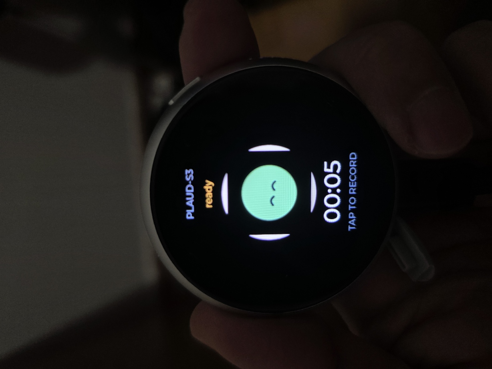
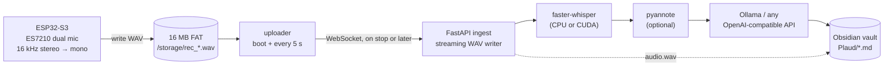

# plaud-s3

**A Plaud-Note-style voice recorder you own end to end.** An ESP32-S3 watch-style board records
dual-mic audio to its own flash first, uploads it to a server on your LAN whenever that server
is reachable, and the server writes the transcript, summary and Markdown note straight into
your Obsidian vault.

No vendor cloud, no subscription minutes, no phone app in the middle.




*Prototype in hand — this photo is from an earlier UI build; the current screen uses the
avatar states below.*

---

## What it does

- **Record offline** — audio is written to a 16 MB FAT partition as a WAV; the uploader sends
  it when the server is reachable, so a dead LAN or a reboot loses nothing.
- **Record** — tap the screen or a side key; the ES7210 reads two digital mics at 16 kHz.
- **Pause and resume** — tap again; the paused stretch is dropped server-side, so the WAV has
  no silent gap and the timer excludes it.
- **Transcribe** — `faster-whisper` on your machine (or any GPU box you point it at).
- **Label speakers** — optional `pyannote` diarization, with a Hugging Face token.
- **Write notes** — summaries, action items and topics from any OpenAI-compatible endpoint
  (Ollama by default), with an honest "no summary" fallback when no LLM answers.
- **Publish** — `audio.wav`, `transcript.{txt,json}`, `notes.md`, `meta.json` per recording,
  plus a copy under `<vault>/Plaud/`.

If the model is unreachable, nothing is invented: the note says so and keeps the raw transcript.

## Architecture



The device is a thin capture client on purpose: no model, no transcript, no cloud state. It only
owns the audio it has not managed to upload yet.

## Hardware

| Property | Value |
|---|---|
| Board | Waveshare ESP32-S3-Touch-AMOLED-1.75C |
| MCU | ESP32-S3, 32 MB flash, 8 MB octal PSRAM |
| Display | 1.75″ 466×466 QSPI AMOLED (CO5300), CST9217 touch |
| Audio | dual digital mics via ES7210 ADC, ES8311 codec, speaker |
| Sensors / power | QMI8658 IMU, AXP2101 PMIC |
| Buttons | Key1 → GPIO0 (BOOT); Key2 → AXP2101 `PWRON` (not a GPIO) |
| Storage | 16 MB FAT partition (`/storage`, wear-levelled), ~8 min at 16 kHz mono |
| USB | native USB-Serial/JTAG (`303a:1001`) |

A 16 MB flash backup covering the bootloader, partition table, `nvs` and factory app was taken before the first flash.

## Repository layout

```
firmware/
  main/main.c        boot: display, UI, Wi-Fi, recorder, buttons
  main/recorder.c    codec → downmix → WebSocket state machine (idle/record/pause/stop)
  main/ui.c          LVGL screen: DiceBear avatar, timer, hint, long-press stop
  main/buttons.c     GPIO0 polling + AXP2101 PWRON interrupt-status polling
  main/avatars.c     baked 180×180 RGB565 avatars (generated)
  assets/avatars/    source PNGs from DiceBear
server/
  app/main.py        /ws/audio, /health, /recordings
  app/pipeline.py    ASR, optional diarization, LLM notes, vault export
  app/wavio.py       streaming WAV writer
  tools/send_wav.py  replay a WAV through the real protocol
  tests/             15 tests (protocol, concurrency, failure paths)
scripts/
  configure_wifi.sh  credentials → sdkconfig.local → BSP patch → build
  gen_avatars.py     fetch DiceBear variants and bake them into C arrays
  patch_bsp_display.sh  display-driver fixes after the component manager refetches
docs/images/         README assets
```

## Quick start

### 1. Server

```bash
cd server
python3 -m venv .venv && .venv/bin/pip install -e .[dev]
PLAUD_DATA_DIR=./data \
PLAUD_VAULT_DIR="$HOME/Documents/Obsidian" \
  .venv/bin/uvicorn app.main:app --host 0.0.0.0 --port 8000
```

First recording downloads the ASR model (`small` by default, ~460 MB). Configuration is
environment-only; see [`.env.example`](server/.env.example).

### 2. Credentials and firmware

Credentials never live in git. `scripts/wifi.env` and `firmware/sdkconfig.local` are ignored.

```bash
cp scripts/wifi.env.example scripts/wifi.env
$EDITOR scripts/wifi.env          # 2.4 GHz SSID + password + ws://<server-ip>:8000/ws/audio
./scripts/configure_wifi.sh       # regenerates sdkconfig, patches the BSP, builds
```

Requires ESP-IDF 5.5.x: `source ~/esp-idf/export.sh` first.

### 3. Flash

```bash
cd firmware
idf.py -p /dev/ttyACM0 flash monitor
```

On WSL with the device still bound to Windows, flash from PowerShell instead — and write the
three images individually, because a merged image at `0x0` would also overwrite the `nvs`
partition at `0x9000`:

```powershell
py -3 -m esptool --chip esp32s3 -p COM4 -b 921600 write_flash `
  --flash_mode dio --flash_freq 80m --flash_size 32MB `
  0x0 bootloader.bin 0x8000 partition-table.bin 0x10000 plaud_s3.bin
```

### 4. Use it

Tap the avatar to record, tap to pause, tap to resume, hold to stop and save. The note appears
in `<vault>/Plaud/` a few seconds later.

## UI states


All states share one DiceBear `gaze` mascot (10.x); body colour and eye variant carry the mood.

| State | Shape | Eyes | Body | Hint |
|---|---|---|---|---|
| connecting | circle | `dots` | `#9cc8fb` | WAIT |
| ready | circle | `happy` | `#9bd78d` | TAP TO RECORD |
| recording | circle | `wide` | `#fbabaf` | TAP PAUSE  HOLD STOP |
| paused | circle | `tall` | `#f2c14e` | TAP RESUME  HOLD STOP |
| saving | circle | `squint` | `#d8b1fb` | WAIT |
| offline | circle | `bars` | `#fbb271` | TAP TO RETRY |

DiceBear exposes variants as `<component>Variant` query parameters (`shapeVariant`,
`eyesVariant`, …) and colours as `bodyColor` / `inkColor` / `glintColor`. The generator pins
them, so a style refresh cannot silently change the look.

## Controls

| Input | Idle | Recording | Paused |
|---|---|---|---|
| Tap avatar | start | pause | resume |
| Hold avatar | — | stop & save | stop & save |
| Key1 tap | start | pause | resume |
| Key1 hold | — | stop & save | stop & save |
| Key2 tap | start | stop & save | stop & save |
| Key2 hold | handled by the PMIC | handled by the PMIC | handled by the PMIC |

Key1 is a plain GPIO0 button (10K pull-up, 100 nF debounce) polled every 20 ms with a
3-sample debounce. Key2 pulls the AXP2101 `PWRON` pin: presses are only visible in `INTSTS2`
(`PKEY_SHORT` / `PKEY_LONG`), which the firmware polls over I2C and clears with
write-1-to-clear semantics. Long-press power-off stays with the PMIC.

## Protocol

One WebSocket, JSON text frames plus binary PCM.

| Direction | Message | Meaning |
|---|---|---|
| device → server | `{"type":"start","device":"…","rate":16000}` | open a session; only 16 kHz accepted |
| server → device | `{"type":"started","id":"20261103-184124-ab12"}` | session id (`YYYYMMDD-HHMMSS-xxxx`) |
| device → server | binary frames | mono s16le, any chunk size |
| device → server | `{"type":"pause"}` / `{"type":"resume"}` | frames between them are discarded |
| server → device | `{"type":"paused"}` / `{"type":"resumed"}` | acknowledgement |
| device → server | `{"type":"stop"}` | close the WAV and run the pipeline |
| server → device | `{"type":"done","id":"…","duration":42.0,"notes":"…"}` | pipeline finished (or failed; audio is kept) |
| both | `{"type":"ping"}` / `{"type":"pong"}` | keepalive |

A dropped socket finalises the recording exactly like `stop` does. Two devices can record at
once; session ids are unique per start.

## Configuration

Server (environment):

| Variable | Default | Meaning |
|---|---|---|
| `PLAUD_DATA_DIR` | `./data` | recordings, transcripts, notes |
| `PLAUD_VAULT_DIR` | unset | also copy notes to `<dir>/Plaud/` |
| `PLAUD_ASR_MODEL` | `small` | `tiny`…`large-v3` |
| `PLAUD_ASR_DEVICE` / `PLAUD_ASR_COMPUTE` | `cpu` / `int8` | `cuda` + `float16` for GPU |
| `PLAUD_LANGUAGE` | auto | force a language |
| `PLAUD_DIARIZE` / `PLAUD_HF_TOKEN` | off | pyannote speaker labels |
| `PLAUD_LLM_BASE_URL` / `PLAUD_LLM_MODEL` | Ollama `127.0.0.1:11434/v1` / `llama3.2` | notes backend |
| `PLAUD_LLM_TIMEOUT` | 8 | seconds before "no summary" fallback |

Firmware (`menuconfig → Plaud-S3 recorder`): Wi-Fi SSID/password, server URL, device name,
channels, and `PLAUD_AUTOTEST_SECONDS` (0 = off).

## Testing

```bash
cd server && PYTHONPATH=. ../.venv/bin/python -m pytest -q   # 15 tests
```

Covered: WAV header integrity, ingest, pause/resume (frames dropped while paused),
stop-while-paused, abrupt disconnect finalisation, malformed JSON, unsupported sample rate,
two concurrent sessions, pipeline crash isolation, honest no-LLM notes, vault publishing and
the HTTP surface.

On device, `CONFIG_PLAUD_AUTOTEST_SECONDS=N` runs record → pause → resume → stop after boot, so
the whole radio/audio path can be exercised from serial without touching the panel. An 11 s
speech clip streamed through the same protocol transcribes correctly and lands in the vault.

The offline path was exercised with the server stopped: the board recorded to `/storage`, the
pending file survived a reboot, and it uploaded itself once the server returned.

The two switches and the touch panel still need a human.

## Troubleshooting

| Symptom | Cause / fix |
|---|---|
| `esp_lcd ... ESP_ERR_NO_MEM` and half-drawn widgets | BSP render bands exceed the DMA budget. `scripts/patch_bsp_display.sh` sets 20-row bands and caps `max_transfer_sz`; `configure_wifi.sh` applies it, and a clean component fetch requires re-running it |
| Stale bands after a large restyle | Partial refresh on this panel. Change avatars/text rather than restyling large widgets; the UI does that already |
| `usbipd bind` access denied | Needs an elevated shell; `attach --wsl` then gives `/dev/ttyACM0` |
| Device connects to Wi-Fi but not the server | WSL mirrored networking plus Windows firewall. Allow TCP 8000 inbound or run the ingest on the Windows host |
| `no Wi-Fi - check config` on screen | `scripts/wifi.env` empty; rerun `configure_wifi.sh` |
| Notes say "No language model was reachable" | Start Ollama or set `PLAUD_LLM_BASE_URL`; the transcript is unaffected |
| Diarization fails | `PLAUD_HF_TOKEN` missing or the pyannote model terms were not accepted |

## Limits and roadmap

Deliberate for v0:

- **~8 minutes of local audio.** 16 MB FAT at 32 KB/s; a full partition stops the recording with `storage full`.
- **Retries are not deduplicated.** If the socket dies mid-upload, the next attempt starts a new
  server session; the local file is only deleted after the server acknowledges `done`.
- **16 kHz mono.** Enough for ASR, not a hi-fi recorder.
- **No authentication.** The WebSocket is open on the LAN — do not expose it to the internet.
- **One pipeline at a time.** `faster-whisper` is not parallelised across recordings.
- **No OTA, no wake word, no VAD gating** on the device.

Next: resumable/deduplicated uploads, a shared token between device and server, OTA, and locally
animated avatars (two baked frames) instead of a static PNG.

## Credits

- [Waveshare ESP32-S3-Touch-AMOLED-1.75C BSP](https://github.com/waveshareteam/ESP32-S3-Touch-AMOLED-1.75C) — Apache-2.0
- [DiceBear](https://www.dicebear.com/) `gaze` style — CC0 1.0
- [LVGL](https://lvgl.io/) — MIT · [faster-whisper](https://github.com/SYSTRAN/faster-whisper) — MIT
- [pyannote.audio](https://github.com/pyannote/pyannote-audio) — MIT · [FastAPI](https://fastapi.tiangolo.com/) — MIT

This is an independent project. It is not affiliated with, endorsed by, or supported by
Plaud Inc.; “Plaud” is used only to describe the interaction pattern.
